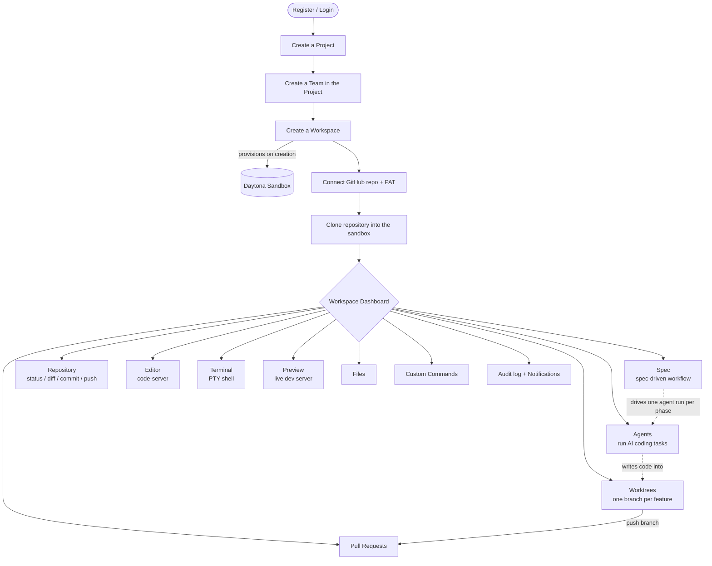
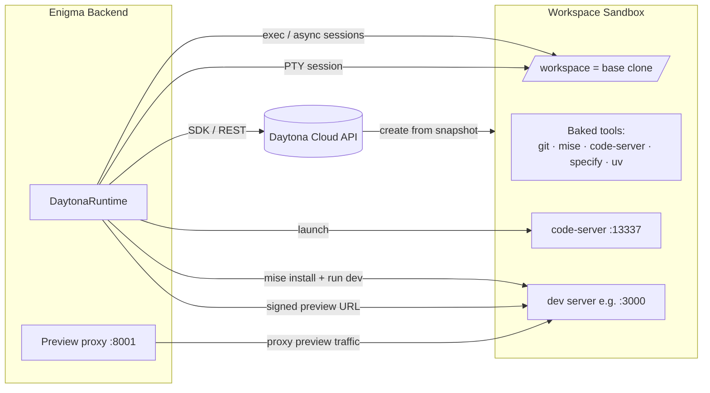
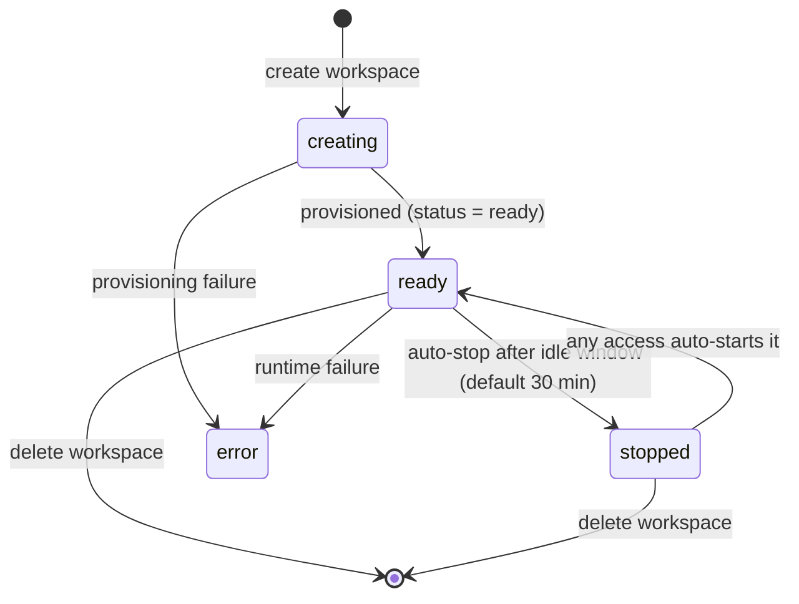
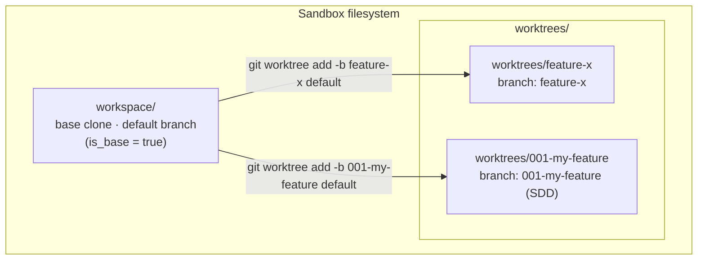
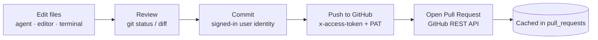

# Enigma

AI agent workspace platform built with FastAPI, React, PostgreSQL, and Redis.

Organises work in a three-tier hierarchy: **Projects → Teams → Workspaces**.
Each workspace is a persistent [Daytona](https://daytona.io/) sandbox with a full dev
environment — git, files, terminal, AI agent runner, `code-server` editor, live preview server,
and a spec-driven development pipeline. The agent and every git/build operation execute **inside**
the sandbox; the platform only orchestrates them.

## Contents

- [Features](#features)
- [How it works](#how-it-works)
  - [Using the application](#using-the-application)
  - [Sandbox strategy](#sandbox-strategy)
  - [Git strategy](#git-strategy)
- [Quick Start](#quick-start)
- [Services](#services)
- [Development](#development)
- [Environment](#environment)
- [Production deployment](#production-deployment)
- [Sandbox snapshot](#sandbox-snapshot)

## Features

The workspace dashboard exposes each capability as a surface (tab):

| Surface | What it does |
|---|---|
| **Overview & Settings** | Create the workspace, view sandbox status, manage encrypted per-workspace environment variables. |
| **Repository** | Create a workspace from a template, blank, or an existing repo on GitHub, GitLab, Bitbucket, or any git host; authenticate with an access token or a server-generated SSH deploy key; clone, view `git status`/diff per file, commit, pull, push. |
| **Worktrees** | Create one git worktree per feature branch inside the sandbox so several branches live side-by-side; commit/push and track ahead/behind counts per worktree. |
| **Pull Requests** | Open and list GitHub pull requests from a worktree branch via the GitHub REST API (cached locally). Other providers: push the branch and open the MR/PR on the host. |
| **Spec (SDD)** | Run the GitHub Spec Kit pipeline (`constitution → specify → clarify → plan → analyze → tasks → implement`) with human review gates between phases. |
| **Agents** | Run an AI coding agent against the sandbox; stream thinking/tool-call events live over WebSocket, review the files it changed, and stop a run mid-flight. |
| **Editor** | `code-server` (VS Code in the browser) embedded directly in the dashboard, served through the preview proxy on a stable per-workspace hostname. Pick which worktree to open, reload the frame, or pop it out into its own tab. |
| **Terminal** | Full interactive PTY shell into the sandbox over WebSocket (`xterm.js`). |
| **Preview** | After clone, auto-detect the project toolchain via `mise` and install dependencies (environment only — the app is not started). A **Run App** button then runs the `dev` task on demand; the open port is detected and served through a signed preview proxy. |
| **Files** | Browse the workspace tree, read, upload, and manage files. |
| **Custom Commands** | Save and run reusable shell commands, streaming output back to the UI. |
| **Audit & Notifications** | Every workspace action is recorded to an audit log; long-running events (agent runs, pushes, PRs, spec phases) raise notifications. |

Supporting platform features: cookie-based authentication (the first registered user becomes the
platform owner), project/team membership and roles, a dashboard overview across workspaces, and
**Global Settings** (below) for the platform-wide LLM connection.

### Global LLM settings

The agent needs an **OpenAI-compatible** endpoint. Rather than only reading it from the server's
environment, Enigma stores it in the database so it can be set from the UI:

- **Who** — only the platform owner (the first registered user) can read or change it. Everyone
  else can see *whether* it is configured, so the UI can explain why agent runs are blocked.
- **Where** — **Settings** in the sidebar (`/settings`). On first run, an authenticated user is
  sent to `/setup` until an endpoint is saved; that prompt is skippable.
- **What** — base URL, model, and an optional API key (local runtimes such as Ollama and LM
  Studio need none). The key is Fernet-encrypted with `WORKSPACE_ENV_ENCRYPTION_KEY` and is never
  returned by the API — the UI shows a mask and never prefills it. **Test connection** probes
  `GET {base_url}/models` (falling back to a one-token chat completion) and populates the model
  dropdown.
- **Precedence** — **stored settings → `OPENHANDS_LLM_*` environment → refuse.** Existing
  env-configured deployments keep working untouched. With nothing configured, creating an agent
  run returns **503** with an actionable message instead of silently using the mock provider
  (set `AGENT_ALLOW_MOCK_PROVIDER=true` to opt back into the mock).

A stored configuration always drives the OpenHands/LiteLLM provider, because it is the only one
that accepts a base URL — the direct `openai` provider hardcodes `api.openai.com`.

## How it works

### Using the application



**Flow in words:** authenticate → create a project → add a team → create a workspace (this
provisions a Daytona sandbox) → connect a GitHub repository and clone it → then work through the
dashboard surfaces. The AI agent and the Spec Kit pipeline both write code into the sandbox (into a
feature worktree), which you commit, push, and turn into a pull request.

### Sandbox strategy

Every workspace owns one long-lived Daytona sandbox. The backend never runs user code locally — it
proxies file, command, terminal, editor, and preview operations into the sandbox through
`DaytonaRuntime` (`backend/app/services/daytona_runtime.py`).



Sandbox lifecycle (cost-managed: idle sandboxes stop automatically and resume on next access):



Key points:

- **One sandbox per workspace**, named `execute-<workspace-id>`, created from a snapshot, private,
  with auto-stop on idle and auto-delete disabled. Re-provisioning is idempotent (it reuses an
  existing sandbox of the same name).
- **Custom snapshot required.** The sandbox network blocks runtime `curl | sh` installs, so `mise`,
  `code-server`, the `specify` CLI (Spec Kit), and `uv` are **baked into the image at build time**
  (`daytona/Dockerfile`). See [Sandbox snapshot](#sandbox-snapshot).
- **Confined agent tools.** The agent can only `list_files`, `read_file`, `write_file`, and
  `run_command` (`backend/app/services/agent_tools.py`). Commands are denylisted (no `git`, `rm`,
  `curl`, `sudo`, shell operators, …) and every path is confined to the workspace (or worktree) root.
- **Preview** prepares the environment after clone by running the project's `mise` `install` task in
  the background (toolchain + dependencies only). The app's `dev` task is started on demand from the
  **Run App** button; the panel then polls for the open port and exposes it through the preview proxy
  on port 8001 using short-lived signed URLs. An app that was run auto-resumes after a sandbox sleep.
- **Editor** runs `code-server` on port 13337 inside the sandbox and serves it through the same
  proxy, on a **stable** hostname (`editor-<token>.<proxy-host>`) minted once per workspace. The
  hostname has to be stable because code-server keeps its whole workbench state (open editors,
  layout, settings) in `localStorage`, which is keyed by origin — a rotating capability URL would
  reset the editor about once an hour. Because the URL therefore carries no credential, the browser
  is authorised instead by a short-lived, signed, `HttpOnly` grant cookie: the dashboard loads the
  iframe once with a one-shot grant in the query string, the proxy exchanges it for the cookie, and
  every later request (including code-server's WebSocket) rides that. The cookie is `Partitioned`
  (CHIPS) because it is always set on a cross-site iframe.

### Git strategy

The base clone lives at `workspace/` on the default branch. Feature work happens in **git
worktrees** under a managed `worktrees/` sibling directory, so multiple branches are checked out at
once without switching the base tree. The Spec Kit pipeline uses the same mechanism (one worktree
per feature, branch `NNN-slug`).



Commit → push → PR lifecycle (credentials stay server-side; the PAT is Fernet-encrypted and never
returned to the client, and all git/API output is sanitised to redact tokens):



Key points:

- **Base worktree + feature worktrees.** The base clone is tracked as the `is_base` worktree; up to
  `MAX_WORKTREES_PER_WORKSPACE` (default 5) feature worktrees can exist. The DB and on-disk worktrees
  are reconciled on every list (adopt new ones, drop removed ones).
- **Push-ready branches.** Each feature worktree is configured with `push.autoSetupRemote=true` and
  `push.default=current`, so the first credentialed push creates and tracks the remote branch.
- **Multi-provider git.** Repo URLs (HTTPS or SSH) are validated and canonicalised per provider in
  `services/git_providers.py`; token auth rides on a per-command HTTP basic header with the
  provider's username (`x-access-token` / `oauth2` / `x-token-auth`), SSH auth uses a
  server-generated deploy key materialised in the sandbox only for the duration of a command.
- **Pull requests** are created from a worktree's branch into the default branch via the GitHub REST
  API and cached in the `pull_requests` table for listing.
- **Spec-Driven Development** commits each phase's artifact to the feature branch
  (`spec(<slug>): <phase>`) and hard-gates `implement` until `plan` and `tasks` are approved.

## Quick Start

### Prerequisites

- [Podman](https://podman.io/) (or Docker) with Compose support — `podman` is the default.
- A [Daytona](https://daytona.io/) account and API key.
- An LLM endpoint for the agent (an OpenAI API key, or any OpenAI-compatible endpoint for OpenHands).

### Steps

1. Copy the example environment file and fill in your values:
   ```bash
   cp .env.example .env
   ```
   At minimum set `DAYTONA_API_KEY` and an agent provider (see [Environment](#environment)).

2. Start all services:
   ```bash
   podman compose up --build -d
   # or: docker compose up --build -d
   ```

3. Run database migrations (required on first start and after any update):
   ```bash
   podman compose exec backend uv run alembic upgrade head
   # or inside the backend directory without containers:
   # cd backend && uv run alembic upgrade head
   ```

4. Open the app:
   - Frontend: http://localhost:5173
   - Backend API: http://localhost:8000 (docs at `/docs`)
   - Health check: http://localhost:8000/health

5. Register an account. The first user automatically becomes the platform owner.

### First-time workflow

1. Log in and create a **Project**.
2. Inside the project, create one or more **Teams**.
3. Inside a team, create a **Workspace** — this provisions a Daytona sandbox.
4. On the **Repository** tab, connect a repository (token or SSH deploy key) and click **Clone** —
   or create the workspace from a template / blank and connect a remote later.
5. Use the workspace surfaces: run the **Agent** or the **Spec** pipeline, branch in **Worktrees**,
   open a **Terminal** or **Editor**, watch the **Preview**, then **commit / push** and open a
   **Pull Request**.

## Services

| Service | Port | Notes |
|---|---|---|
| Frontend (Vite + React) | 5173 | Hot-reload in dev mode |
| Backend (FastAPI) | 8000 | Auto-reload with `--reload`; API docs at `/docs` |
| Preview proxy | 8001 | Proxies Daytona sandbox preview URLs and the embedded editor |
| PostgreSQL 16 | 5432 | Persisted in `postgres_data` volume |
| Redis 7 | 6379 | Persisted in `redis_data` volume |

## Development

Run backend tests / lint / migrations (`backend/`):
```bash
cd backend
uv sync
uv run pytest
uv run ruff check .
uv run alembic upgrade head
```

Run frontend checks (`frontend/`):
```bash
cd frontend
pnpm install
pnpm lint
pnpm test
pnpm build
```

> See `AGENTS.md` for the full command reference, architecture notes, and gotchas (async-only
> backend, `asyncpg` driver, `podman` default, custom router/no-component-library frontend, …).

## Environment

Copy `.env.example` to `.env`. Key variables:

| Variable | Required | Description |
|---|---|---|
| `DAYTONA_API_KEY` | Yes | Daytona API key for sandbox provisioning |
| `DAYTONA_API_URL` | No | Override for self-hosted Daytona (default: `https://app.daytona.io/api`) |
| `DAYTONA_TARGET` | No | Daytona target region |
| `DAYTONA_DEFAULT_SNAPSHOT` | Recommended | Custom snapshot name (e.g. `enigma-mise-code`) — needed for preview/editor/SDD (see below) |
| `DAYTONA_AUTO_STOP_MINUTES` | No | Idle minutes before a sandbox auto-stops (default `30`) |
| `AUTH_SECRET_KEY` | Yes (prod) | Secret for signing session tokens — change from default in production |
| `WORKSPACE_ENV_ENCRYPTION_KEY` | Yes (prod) | Fernet key for encrypting workspace env vars, repo tokens, and the global LLM API key. Rotating it invalidates all three |
| `AGENT_PROVIDER` | No | Agent engine: `openhands`, `openai`, or `auto`. **Fallback only** — the global LLM settings stored from the UI take precedence |
| `OPENHANDS_LLM_BASE_URL` / `OPENHANDS_LLM_API_KEY` / `OPENHANDS_LLM_MODEL` | No | Fallback OpenAI-compatible endpoint. Overridden by the DB-backed global LLM settings |
| `OPENAI_API_KEY` / `OPENAI_MODEL` | If `openai` | Credentials for the direct OpenAI Responses provider (cannot take a custom base URL) |
| `AGENT_ALLOW_MOCK_PROVIDER` | No | Allow the mock agent when nothing is configured (default `false`, so runs fail with a clear 503 instead) |
| `MAX_WORKTREES_PER_WORKSPACE` | No | Feature-worktree cap per workspace (default `5`) |
| `EDITOR_AUTO_INSTALL` | No | `false` when `code-server` is baked into the snapshot |

Full list of variables: see `.env.example` and `backend/app/core/config.py`.

## Production deployment

Compose is the dev setup (`--reload`, bind mounts). Production runs on Kubernetes from
`deploy/k8s` (Kustomize), using the default (last) stage of each Dockerfile: separate API,
worker (KEDA, scales on queue depth) and preview-proxy deployments, a static nginx frontend,
zero-downtime rolling updates, and a migrate Job before every rollout. Secrets, release steps,
rollback and scaling knobs: [`deploy/README.md`](deploy/README.md).

## Sandbox snapshot

The Daytona snapshot used by each workspace must provide a Linux shell, Git, Python 3, and standard
networking/process utilities. For the **preview**, **editor**, and **spec-driven development**
features it must also ship `mise`, `code-server`, and the `specify` CLI — the stock
`daytonaio/sandbox` image lacks these and **cannot** install them at runtime because sandbox egress
blocks `curl | sh`.

Build and publish the custom snapshot (build host needs network access; tools are baked in):
```bash
./daytona/build-snapshot.sh        # builds snapshot "enigma-mise-code"
```
Then set `DAYTONA_DEFAULT_SNAPSHOT=enigma-mise-code` in `.env` and recreate existing workspaces so
they pick up the new image. See `daytona/Dockerfile` and `daytona/README.md` for details.
