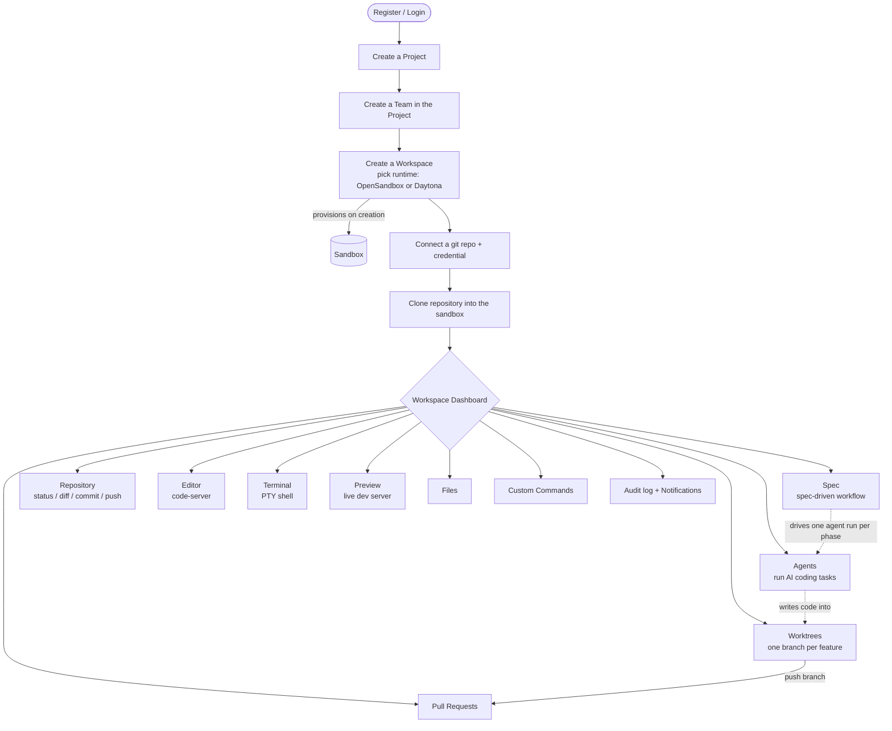
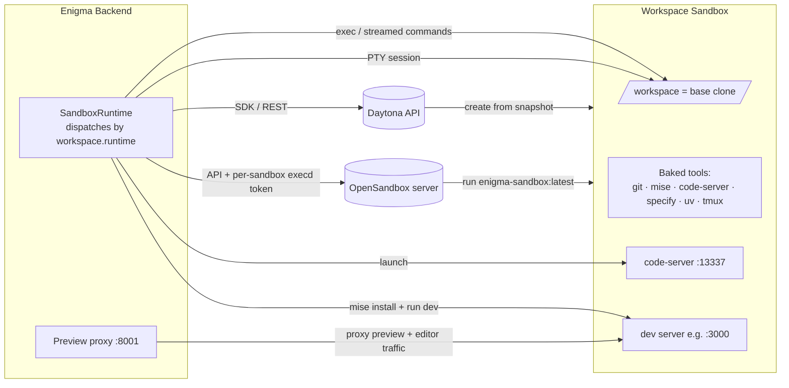
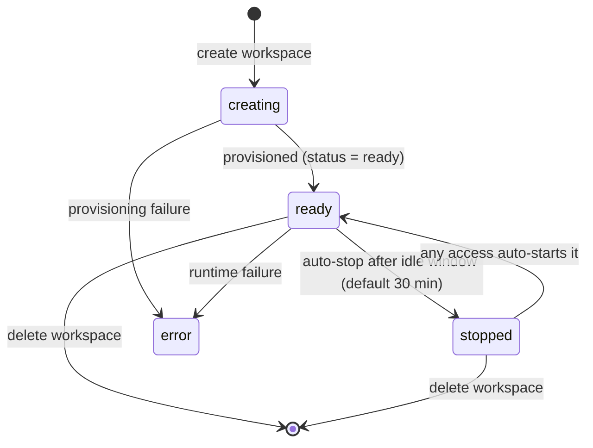
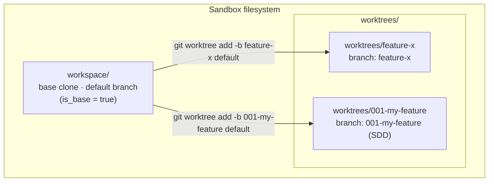
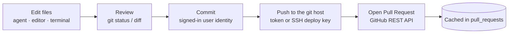

# Enigma

AI agent workspace platform built with FastAPI, React, PostgreSQL, and Redis.

Organises work in a three-tier hierarchy: **Projects → Teams → Workspaces**.
Each workspace is an isolated sandbox with a full dev environment — git, files, terminal, AI agent
runner, `code-server` editor, live preview server, and a spec-driven development pipeline. The
sandbox runs either on [Daytona](https://daytona.io/) or on a self-hosted
[OpenSandbox](https://github.com/opensandbox-group/OpenSandbox) server **on your own machine**, so
Enigma can be fully self-hosted without any subscription. The agent and
every git/build operation execute **inside** the sandbox; the platform only orchestrates them.

## Contents

- [Features](#features)
- [How it works](#how-it-works)
  - [Using the application](#using-the-application)
  - [Sandbox runtimes](#sandbox-runtimes)
  - [Sandbox strategy](#sandbox-strategy)
  - [Git strategy](#git-strategy)
- [Quick Start](#quick-start)
  - [Option A: OpenSandbox sandboxes (no subscription)](#option-a-opensandbox-sandboxes-no-subscription)
  - [Option B: Daytona sandboxes](#option-b-daytona-sandboxes)
- [Services](#services)
- [Development](#development)
- [Environment](#environment)
- [Production deployment](#production-deployment)
- [Sandbox image](#sandbox-image)
- [Documentation](#documentation)
- [Contributing](#contributing)
- [Security](#security)
- [License](#license)

## Features

The workspace dashboard exposes each capability as a surface (tab):

| Surface | What it does |
|---|---|
| **Overview & Settings** | Create the workspace (choosing its sandbox runtime), view sandbox status, manage encrypted per-workspace environment variables. |
| **Repository** | Create a workspace from a template, blank, or an existing repo on GitHub, GitLab, Bitbucket, or any git host; authenticate with an access token or a server-generated SSH deploy key; clone, view `git status`/diff per file, commit, pull, push. |
| **Worktrees** | Create one git worktree per feature branch inside the sandbox so several branches live side-by-side; commit/push and track ahead/behind counts per worktree. |
| **Pull Requests** | Open and list GitHub pull requests from a worktree branch via the GitHub REST API (cached locally). Other providers: push the branch and open the MR/PR on the host. |
| **Spec (SDD)** | Run the GitHub Spec Kit pipeline (`constitution → specify → clarify → plan → analyze → tasks → implement`) with human review gates between phases. |
| **Agents** | Run an AI coding agent against the sandbox; stream thinking/tool-call events live over WebSocket, review the files it changed, and stop a run mid-flight. Multi-turn sessions, per-team budgets, and usage analytics are built in. |
| **Editor** | `code-server` (VS Code in the browser) embedded directly in the dashboard, served through the preview proxy on a stable per-workspace hostname. Pick which worktree to open, reload the frame, or pop it out into its own tab. |
| **Terminal** | Full interactive PTY shell into the sandbox over WebSocket (`xterm.js`). |
| **Preview** | After clone, auto-detect the project toolchain via `mise` and install dependencies (environment only — the app is not started). A **Run App** button then runs the `dev` task on demand; the open port is detected and served through a signed preview proxy. Multi-service projects get one tracked service per port. |
| **Files** | Browse the workspace tree, read, upload, and manage files. |
| **Custom Commands** | Save and run reusable shell commands, streaming output back to the UI. |
| **Audit & Notifications** | Every workspace action is recorded to an audit log; long-running events (agent runs, pushes, PRs, spec phases) raise notifications. |

Supporting platform features: cookie-based authentication (the first registered user becomes the
platform owner), project/team membership and roles, a dashboard overview across workspaces,
presence and comments for collaboration, and **Global Settings** (below) for the platform-wide
LLM connection.

### Global LLM settings

The agent needs an **OpenAI-compatible** endpoint. Rather than only reading it from the server's
environment, Enigma stores it in the database so it can be set from the UI:

- **Who** — only the platform owner (the first registered user) can read or change it. Everyone
  else can see *whether* it is configured, so the UI can explain why agent runs are blocked.
- **Where** — **Settings** in the sidebar (`/settings`). On first run, an authenticated user is
  sent to `/setup` until an endpoint is saved; that prompt is skippable.
- **What** — base URL, model, and an optional API key (local runtimes such as Ollama and LM
  Studio need none). The key is Fernet-encrypted with `WORKSPACE_ENV_ENCRYPTION_KEY` and is never
  returned by the API — the UI shows a mask and never prefills it. **Test connection** probes
  `GET {base_url}/models` (falling back to a one-token chat completion) and populates the model
  dropdown.
- **Precedence** — **stored settings → `OPENHANDS_LLM_*` environment → refuse.** Existing
  env-configured deployments keep working untouched. With nothing configured, creating an agent
  run returns **503** with an actionable message instead of silently using the mock provider
  (set `AGENT_ALLOW_MOCK_PROVIDER=true` to opt back into the mock).

A stored configuration always drives the OpenHands/LiteLLM provider, because it is the only one
that accepts a base URL — the direct `openai` provider hardcodes `api.openai.com`.

## How it works

### Using the application



**Flow in words:** authenticate → create a project → add a team → create a workspace (this
provisions a sandbox on the runtime you picked) → connect a git repository and clone it → then
work through the dashboard surfaces. The AI agent and the Spec Kit pipeline both write code into
the sandbox (into a feature worktree), which you commit, push, and turn into a pull request.

### Sandbox runtimes

Enigma ships two interchangeable sandbox providers behind one `SandboxRuntime` interface
(`backend/app/services/sandbox/`). A workspace is pinned to the provider it was created with; an
installation can offer one or both, and `/health` reports each.

| | **OpenSandbox** (`runtime="opensandbox"`) | **Daytona** (`runtime="daytona"`) |
|---|---|---|
| What a sandbox is | One container per workspace, managed by an `opensandbox-server` you run (next to the stack or on its own VM) | One Daytona sandbox per workspace, created from a snapshot |
| Needs | Docker Engine 24+ or Podman 5+ for the server, `enigma-sandbox:latest` built locally, `OPENSANDBOX_API_KEY`, `OPENSANDBOX_EXECD_TOKEN_KEY`, `METRICS_TOKEN` | A Daytona account/API key and the published custom snapshot |
| Isolation | Server-wide container floor (`drop_capabilities = ["ALL"]`, `no_new_privileges`, pids limit, non-root), checked by Enigma on every sandbox; a per-sandbox execd token; an egress policy that always denies private ranges (`dns+nft`) | Daytona's isolation plus its network policy |
| Scale | The server runs on one host; Enigma reaches it over a private network, also from Kubernetes (`deploy/k8s/overlays/opensandbox-external`) | Multi-replica Kubernetes deployment (`deploy/k8s`) |
| Cost | Your hardware | Per-sandbox billing; idle sandboxes auto-stop |
| Feature surface | Identical: agent, files, git, terminal, editor, preview, services, worktrees, Spec Kit | Identical |

Both providers run the **same image** (`sandbox/Dockerfile`), so a project behaves the same
wherever it runs. The full operator guide for OpenSandbox is
[`docs/self-host-opensandbox.md`](docs/self-host-opensandbox.md). The custom Docker provider
(`runtime="docker"`) was removed after `v0.1.0`; see
[Moving from Docker](docs/self-host-opensandbox.md#moving-from-docker-upgrading-to-v020) for
leftover workspaces.

### Sandbox strategy

Every workspace owns one long-lived sandbox. The backend never runs user code locally — it
proxies file, command, terminal, editor, and preview operations into the sandbox through the
provider selected for that workspace.



Sandbox lifecycle (cost-managed: idle sandboxes stop automatically and resume on next access):



Key points:

- **One sandbox per workspace**, named `execute-<workspace-id>`, private, with auto-stop on idle.
  Re-provisioning is idempotent (it reuses an existing sandbox of the same name).
- **Custom image required.** The sandbox network blocks runtime `curl | sh` installs, so `mise`,
  `code-server`, the `specify` CLI (Spec Kit), `uv`, and `tmux` are **baked into the image at
  build time** (`sandbox/Dockerfile`). See [Sandbox image](#sandbox-image).
- **Confined agent tools.** The agent can `list_files`, `read_file`, `write_file`, `apply_patch`,
  `search_code`, and `run_command` (`backend/app/services/agent_tools.py`). Commands are
  denylisted by default (no `git`, `rm`, `curl`, `sudo`, shell operators, …) and every path is
  confined to the workspace (or worktree) root.
- **Preview** prepares the environment after clone by running the project's `mise` `install` task in
  the background (toolchain + dependencies only). The app's `dev` task is started on demand from the
  **Run App** button; the panel then polls for the open port and exposes it through the preview proxy
  on port 8001 using short-lived signed URLs. An app that was run auto-resumes after a sandbox sleep.
- **Editor** runs `code-server` on port 13337 inside the sandbox and serves it through the same
  proxy, on a **stable** hostname (`editor-<token>.<proxy-host>`) minted once per workspace. The
  hostname has to be stable because code-server keeps its whole workbench state (open editors,
  layout, settings) in `localStorage`, which is keyed by origin — a rotating capability URL would
  reset the editor about once an hour. Because the URL therefore carries no credential, the browser
  is authorised instead by a short-lived, signed, `HttpOnly` grant cookie: the dashboard loads the
  iframe once with a one-shot grant in the query string, the proxy exchanges it for the cookie, and
  every later request (including code-server's WebSocket) rides that. The cookie is `Partitioned`
  (CHIPS) because it is always set on a cross-site iframe.

### Git strategy

The base clone lives at `workspace/` on the default branch. Feature work happens in **git
worktrees** under a managed `worktrees/` sibling directory, so multiple branches are checked out at
once without switching the base tree. The Spec Kit pipeline uses the same mechanism (one worktree
per feature, branch `NNN-slug`).



Commit → push → PR lifecycle (credentials stay server-side; the PAT is Fernet-encrypted and never
returned to the client, and all git/API output is sanitised to redact tokens):



Key points:

- **Base worktree + feature worktrees.** The base clone is tracked as the `is_base` worktree; up to
  `MAX_WORKTREES_PER_WORKSPACE` (default 5) feature worktrees can exist. The DB and on-disk worktrees
  are reconciled on every list (adopt new ones, drop removed ones).
- **Push-ready branches.** Each feature worktree is configured with `push.autoSetupRemote=true` and
  `push.default=current`, so the first credentialed push creates and tracks the remote branch.
- **Multi-provider git.** Repo URLs (HTTPS or SSH) are validated and canonicalised per provider in
  `services/git_providers.py`; token auth rides on a per-command HTTP basic header with the
  provider's username (`x-access-token` / `oauth2` / `x-token-auth`), SSH auth uses a
  server-generated deploy key materialised in the sandbox only for the duration of a command.
- **Pull requests** are created from a worktree's branch into the default branch via the GitHub REST
  API and cached in the `pull_requests` table for listing.
- **Spec-Driven Development** commits each phase's artifact to the feature branch
  (`spec(<slug>): <phase>`) and hard-gates `implement` until `plan` and `tasks` are approved.

## Quick Start

### Prerequisites

- [Podman](https://podman.io/) 5+ or Docker Engine 24+ with Compose support — `podman` is the default.
- An LLM endpoint for the agent: any OpenAI-compatible endpoint (OpenAI, a LiteLLM proxy, Ollama,
  LM Studio, …). It can be entered from the UI after first login.
- **Either** a Docker/Podman daemon for a local OpenSandbox server (Option A) **or** a
  [Daytona](https://daytona.io/) account and API key (Option B).

### Option A: OpenSandbox sandboxes (no subscription)

1. Build the sandbox image once (needs network access at build time):
   ```bash
   ./sandbox/build-local-image.sh          # tags enigma-sandbox:latest
   ```

2. Copy the example environment file and set the required secrets:
   ```bash
   cp .env.example .env
   ```
   ```bash
   AUTH_SECRET_KEY=...                  # python3 -c 'import secrets; print(secrets.token_urlsafe(48))'
   WORKSPACE_ENV_ENCRYPTION_KEY=...     # python3 -c 'from cryptography.fernet import Fernet; print(Fernet.generate_key().decode())'
   OPENSANDBOX_API_KEY=...              # long random value; the server's API key
   OPENSANDBOX_EXECD_TOKEN_KEY=...      # long random value; keys each sandbox's execd token
   METRICS_TOKEN=...                    # required with OpenSandbox sandboxes
   DAYTONA_API_KEY=                     # leave empty
   ```
   On macOS or Windows (Podman machine, Docker Desktop), also set
   `OPENSANDBOX_SERVER_CONFIG=sandbox.compose-desktop.toml`. If the daemon socket is not at
   `/var/run/docker.sock`, set `DOCKER_SOCKET` (see the header of `docker-compose.opensandbox.yml`).

3. Start the stack with the OpenSandbox override, which runs the server next to the stack (the
   only service that gets the daemon socket) and makes `opensandbox` the default runtime:
   ```bash
   npm run dev:opensandbox
   # = podman compose -f docker-compose.yml -f docker-compose.opensandbox.yml up --build
   # or: npm run dev:opensandbox:docker
   ```
   Pre-pull `opensandbox/execd:v1.1.0` and `opensandbox/egress:v1.1.7` once, or the first create
   can time out.

4. Run database migrations (required on first start and after any update):
   ```bash
   podman compose exec backend uv run alembic upgrade head
   ```

5. Check `http://localhost:8000/health` — it should report `runtimes.opensandbox.status = "ok"` —
   then open the app, register the first user (the platform owner), and create a workspace.

> **Security note.** The OpenSandbox server holds the daemon socket, which is root-equivalent on
> the host. Run this profile on a machine or VM you are happy to hand to everyone who can log in
> to Enigma, and consider `SANDBOX_NETWORK_ALLOW_LIST` or `SANDBOX_NETWORK_BLOCK_ALL=true` to
> restrict sandbox egress. Server placement, the security controls, upkeep and the security suite
> are in [`docs/self-host-opensandbox.md`](docs/self-host-opensandbox.md).

### Option B: Daytona sandboxes

1. Build and publish the custom snapshot (see [Sandbox image](#sandbox-image)):
   ```bash
   ./daytona/build-snapshot.sh             # publishes snapshot "enigma-mise-code"
   ```

2. Copy the example environment file and fill in your values:
   ```bash
   cp .env.example .env
   ```
   At minimum set `AUTH_SECRET_KEY`, `WORKSPACE_ENV_ENCRYPTION_KEY`, `DAYTONA_API_KEY`, and
   `DAYTONA_DEFAULT_SNAPSHOT=enigma-mise-code`.

3. Start all services:
   ```bash
   podman compose up --build -d
   # or: docker compose up --build -d
   ```

4. Run database migrations:
   ```bash
   podman compose exec backend uv run alembic upgrade head
   ```

5. Open the app and register the first user.

Both options can be combined: keep `DAYTONA_API_KEY` set *and* start with the OpenSandbox override,
and the workspace create form lets each user pick a runtime. `SANDBOX_RUNTIMES_ALLOWED` limits
which ones are offered.

### URLs

- Frontend: http://localhost:5173
- Backend API: http://localhost:8000 (docs at `/docs`)
- Health check: http://localhost:8000/health

### First-time workflow

1. Log in and create a **Project**.
2. Inside the project, create one or more **Teams**.
3. Inside a team, create a **Workspace** and pick its runtime — this provisions the sandbox.
4. On the **Repository** tab, connect a repository (token or SSH deploy key) and click **Clone** —
   or create the workspace from a template / blank and connect a remote later.
5. Use the workspace surfaces: run the **Agent** or the **Spec** pipeline, branch in **Worktrees**,
   open a **Terminal** or **Editor**, watch the **Preview**, then **commit / push** and open a
   **Pull Request**.

## Services

| Service | Port | Notes |
|---|---|---|
| Frontend (Vite + React) | 5173 | Hot-reload in dev mode |
| Backend (FastAPI) | 8000 | Auto-reload with `--reload`; API docs at `/docs` |
| Preview proxy | 8001 | Proxies sandbox previews and the embedded editor for both runtimes |
| Worker (arq) | — | `--profile queue`; executes runs when `RUN_EXECUTION_MODE=queue` |
| OpenSandbox server | 8080 (internal) | `docker-compose.opensandbox.yml` only; manages sandboxes, holds the daemon socket, publishes no host port |
| PgBouncer | 5432 (internal) | `--profile pgbouncer`; optional connection pooler |
| PostgreSQL 16 | 5432 | Persisted in `postgres_data` volume |
| Redis 7 | 6379 | Persisted in `redis_data` volume |

## Development

Run backend tests / lint / migrations (`backend/`):
```bash
cd backend
uv sync
uv run pytest
uv run ruff check .
uv run alembic upgrade head
```

Run frontend checks (`frontend/`):
```bash
cd frontend
pnpm install
pnpm lint
pnpm test
pnpm build
```

The OpenSandbox security suite runs against a real server and is opt-in:
```bash
cd backend && OPENSANDBOX_INTEGRATION_TESTS=1 OPENSANDBOX_API_URL=http://127.0.0.1:8080 \
  OPENSANDBOX_API_KEY=<key> uv run pytest tests/test_opensandbox_integration.py
```
To run it through the compose override, see
[`docs/self-host-opensandbox.md`](docs/self-host-opensandbox.md#the-security-suite).

> See `AGENTS.md` for the full command reference, architecture notes, and gotchas (async-only
> backend, `asyncpg` driver, `podman` default, no-component-library frontend, sandbox provider
> boundary tests, …).

## Environment

Copy `.env.example` to `.env`. Key variables:

| Variable | Required | Description |
|---|---|---|
| `AUTH_SECRET_KEY` | Yes | Secret for signing session tokens. Compose refuses to start without it |
| `WORKSPACE_ENV_ENCRYPTION_KEY` | Yes | Fernet key for encrypting workspace env vars, repo tokens, and the global LLM API key. Rotating it invalidates all three |
| `SANDBOX_RUNTIME_DEFAULT` | No | Provider for new workspaces when the user does not choose: `daytona` (default) or `opensandbox` (the OpenSandbox override sets it) |
| `SANDBOX_RUNTIMES_ALLOWED` | No | Comma-separated providers offered for new workspaces (empty = all; must include the default) |
| `SANDBOX_AUTO_STOP_MINUTES` | No | Idle minutes before a sandbox stops, on both runtimes (default `30`, `0` = never) |
| `SANDBOX_NETWORK_BLOCK_ALL` / `SANDBOX_NETWORK_ALLOW_LIST` | No | Sandbox egress policy: block everything, or allow only the given CIDRs. Applies to both runtimes |
| `DAYTONA_API_KEY` | Option B | Daytona API key for sandbox provisioning. Leave empty for an OpenSandbox-only install |
| `DAYTONA_API_URL` / `DAYTONA_TARGET` | No | Self-hosted Daytona URL / target region |
| `DAYTONA_DEFAULT_SNAPSHOT` | Option B | Custom snapshot name (e.g. `enigma-mise-code`), needed for preview/editor/SDD |
| `METRICS_TOKEN` | Option A | Bearer token for `/health` and `/metrics` on the preview proxy. Required by the OpenSandbox override and outside `ENVIRONMENT=local` |
| `OPENSANDBOX_API_KEY` | Option A | The OpenSandbox server's API key. Without it, OpenSandbox is reported `insecure` and never offered |
| `OPENSANDBOX_EXECD_TOKEN_KEY` | Option A | Keys each sandbox's execd access token. Required outside `ENVIRONMENT=local`; rotating it locks Enigma out of existing sandboxes until they are recreated |
| `OPENSANDBOX_SERVER_CONFIG` | No | Compose only: server config under `deploy/opensandbox/` (default `sandbox.compose.toml`; `sandbox.compose-desktop.toml` on Podman machine / Docker Desktop) |
| `RUN_EXECUTION_MODE` | No | `inline` (default, runs inside the API) or `queue` (arq workers) |
| `AGENT_PROVIDER` | No | Agent engine: `openhands`, `openai`, or `auto`. **Fallback only** — the global LLM settings stored from the UI take precedence |
| `OPENHANDS_LLM_BASE_URL` / `OPENHANDS_LLM_API_KEY` / `OPENHANDS_LLM_MODEL` | No | Fallback OpenAI-compatible endpoint. Overridden by the DB-backed global LLM settings |
| `OPENAI_API_KEY` / `OPENAI_MODEL` | If `openai` | Credentials for the direct OpenAI Responses provider (cannot take a custom base URL) |
| `AGENT_ALLOW_MOCK_PROVIDER` | No | Allow the mock agent when nothing is configured (default `false`, so runs fail with a clear 503 instead) |
| `MAX_WORKTREES_PER_WORKSPACE` | No | Feature-worktree cap per workspace (default `5`) |
| `PREVIEW_PROXY_BASE_URL` / `PREVIEW_PROXY_TTL_SECONDS` | No | Public base URL of the preview proxy and signed-URL lifetime |

The `DAYTONA_*` spellings of the neutral `SANDBOX_*` / `PREVIEW_PROXY_*` settings are still
accepted for one release and logged as deprecated. Full list of variables: see `.env.example`
and `backend/app/core/config.py`.

## Production deployment

Compose is the dev and single-host self-host setup (`--reload`, bind mounts). Production runs on
Kubernetes from `deploy/k8s` (Kustomize), using the default (last) stage of each Dockerfile:
separate API, worker (KEDA, scales on queue depth) and preview-proxy deployments, a static nginx
frontend, zero-downtime rolling updates, and a migrate Job before every rollout. The Kubernetes
deployment uses Daytona, or an OpenSandbox server on a dedicated VM outside the cluster
(`deploy/k8s/overlays/opensandbox-external`). Secrets, release steps, rollback and scaling knobs:
[`deploy/README.md`](deploy/README.md).

## Sandbox image

Both runtimes use the same image definition, `sandbox/Dockerfile`. It provides a Linux shell,
Git, Python 3, standard networking/process utilities, and, for the **preview**, **editor**, and
**spec-driven development** features, `mise`, `code-server`, `uv`, `tmux`, and the `specify` CLI.
The stock `daytonaio/sandbox` image lacks these and **cannot** install them at runtime because
sandbox egress blocks `curl | sh`. The build host needs network access; the tools are baked in.

```bash
./sandbox/build-local-image.sh     # OpenSandbox: tags enigma-sandbox:latest on the local daemon
./daytona/build-snapshot.sh        # Daytona: builds and publishes snapshot "enigma-mise-code"
```

For Daytona, set `DAYTONA_DEFAULT_SNAPSHOT=enigma-mise-code` in `.env`. Recreate existing
workspaces after an image change so they pick it up. See `daytona/README.md` for details.

## Documentation

- [`docs/self-host-opensandbox.md`](docs/self-host-opensandbox.md) — operator guide for self-hosting with OpenSandbox.
- [`deploy/README.md`](deploy/README.md) — Kubernetes runbook.
- [`AGENTS.md`](AGENTS.md) — architecture, commands, and gotchas for contributors (human and AI).
- `docs/implementation-plan/` — the original MVP build plan.
- `docs/improvement-epics/` — post-MVP feature epics.
- `docs/horizontal-scale/` — control-plane scaling (queue mode, leases, retention, stateless proxy, Kubernetes).
- `docs/hybrid-runtime-migration/`, `docs/copilot-workspace-parity/` — planned work.

## Contributing

Contributions are welcome. Please read [`CONTRIBUTING.md`](CONTRIBUTING.md) for the development
workflow, coding conventions, and the checks a pull request must pass, and
[`CODE_OF_CONDUCT.md`](CODE_OF_CONDUCT.md) for community expectations.

## Security

Enigma runs AI agents and previewed code inside sandboxes, and a self-hosted OpenSandbox server
holds the daemon socket. Please report vulnerabilities privately as described in
[`SECURITY.md`](SECURITY.md) rather than opening a public issue.

## License

Enigma is licensed under the **GNU Affero General Public License v3.0** (AGPL-3.0-only).
See [`LICENSE`](LICENSE). If you run a modified version of Enigma as a network service, the
AGPL requires you to offer the corresponding source to its users.
