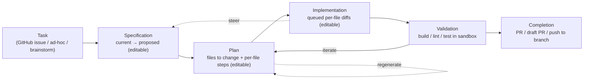

# Copilot-Workspace-Style Task Mode — Plan Index

This folder is a plan for reshaping Enigma's agent experience to feel like
**GitHub Copilot Workspace**: a task-centric, fully steerable loop that goes
**Task → Specification → Plan → Implementation → Validation → Pull Request**, where a
human can read and *directly edit* every artifact before the next step runs.

It complements the existing plans and does **not** replace them:

- `docs/implementation-plan/` — the original MVP build (Epics 0–11).
- `docs/improvement-epics/` — post-MVP backlog (SDD, PRs, agent tools, Claude, etc.).
- `docs/hybrid-runtime-migration/` — runtime portability off pure Daytona.

Everything here assumes the MVP works end to end and builds on the **already-shipped**
building blocks: the agent runner + WebSocket streaming, git worktrees, the GitHub PR
client, the Spec Kit SDD pipeline, the terminal, the preview/dev-server, and files.

## What Copilot Workspace is (and its status)

Copilot Workspace was a GitHub Next research preview of a "Copilot-native" developer
environment. Its defining idea was a **steerable, task-centric loop**: you start from a
GitHub issue (or an ad-hoc task), Copilot proposes a **spec** (current behaviour vs the
success criteria after the change), then a **plan** (which files change, and the exact
steps per file), then the **implementation** (per-file diffs). You could edit the spec,
the plan, and the diffs in natural language at every step, validate in an integrated
terminal, and finish by opening a PR.

> **Status note.** GitHub retired the Copilot Workspace preview on **May 30, 2025** and
> folded its lessons into shipping products (Copilot **coding agent** — issue → PR — and
> **Agent Mode** in VS Code). We are emulating the *interaction model* that made Workspace
> compelling, not cloning a live product. Where GitHub's own direction is instructive
> (issue-driven, PR-terminating, human-steerable), we follow it.

## The lifecycle we are targeting

The principle running through every box: **everything is editable, and every step is
optional/re-runnable.** Approval gates alone are not enough — the human must be able to
*rewrite* an artifact and have the next step honour it.

## Concept → Enigma mapping (gap analysis)

| Copilot Workspace concept | What Enigma has today | Gap to close | Epic |
|---|---|---|---|
| Task-centric entry from a **GitHub issue** ("Open in Workspace") | Workspaces created manually; free-text prompt to the agent. `github_client.py` is **PR-only** (no issues). | Ingest issues; start a task session from an issue or ad-hoc description; **brainstorm** for open-ended tasks. | 01 |
| Lightweight **session** with a dashboard (recent / bookmarked / completed), auto-save, share, undo | Long-lived workspaces; `agent_runs` are single-`prompt`, no session linkage. | A `task_session` aggregate that links the spec/plan/implement runs; a sessions dashboard. | 01 |
| **Specification**: topic + current-state vs proposed-state bullets; fully editable/regeneratable | Spec Kit `specify`/`clarify` produce a heavy `spec.md`; review is **approve / request-changes** (agent regenerates), not direct edit. | A lightweight current→proposed spec artifact the user can **edit inline**, then continue. | 02 |
| **Plan**: list of files (edit/create/delete/move) with per-file steps; editable + checkboxes; "update selected files" | Spec Kit `tasks.md` is prose markdown; not file-scoped or interactive. | A structured, per-file plan the user edits; selective regeneration of chosen files. | 03 |
| **Implementation**: per-file diffs generated one-by-one; diffs directly editable; iterate | Agent runs write files (`write_file` + `apply_patch`); UI shows "files it changed" and `git diff`. | Plan-driven, queued diffs; inline diff edits; re-run only selected files. | 04 |
| **Integrated validation**: run build/lint/test in a Codespace-backed terminal | Terminal (PTY), preview/dev-server, custom commands all exist. | A first-class **Validate** step tied to the session (detect + run build/lint/test, feed failures back). | 05 |
| **Completion**: create PR / draft PR / push to branch / update PR | Worktrees + `PullRequestService` (create/list) already exist. | Wire session completion to the existing PR/push path; draft-PR + update-PR. | 05 |

## Design decision: a new *Task mode*, alongside Spec Kit

Enigma already has a rigorous, greenfield-oriented SDD pipeline
(`constitution → specify → clarify → plan → analyze → tasks → implement`). It is heavier
than Copilot Workspace on purpose. Rather than bend Spec Kit into a different shape, this
plan adds a **second, lighter mode**:

- **Task mode** (this plan) — the Copilot-Workspace loop. Best for "resolve this issue /
  make this focused change": fast, steerable, ends in a PR.
- **Spec-Driven mode** (existing Epic 01) — the full Spec Kit pipeline. Best for large
  features that deserve durable committed artifacts and hard gates.

Both share the same substrate — agent runner, worktrees, PR client, terminal/preview,
notifications/audit — so this is mostly **orchestration + UI**, not new infrastructure.

## The epics

| # | Epic | Priority | Theme |
|---|------|----------|-------|
| 01 | [Task-Centric Entry & Sessions](./01-task-centric-entry-and-sessions.md) | **P1** | Entry point / model |
| 02 | [Lightweight Specification (current → proposed)](./02-lightweight-specification.md) | **P1** | Steerable spec |
| 03 | [File-Level Editable Plan](./03-file-level-plan.md) | **P1** | Steerable plan |
| 04 | [Steerable Implementation (editable diffs)](./04-steerable-implementation.md) | **P1** | Steerable diffs |
| 05 | [Integrated Validation & Completion](./05-validation-and-completion.md) | P2 | Validate → PR |

## Recommended build order

1. **01 — Task-Centric Entry & Sessions.** The `task_session` model and issue ingestion are
   the backbone everything else hangs off. (Depends on improvement-epic **05 Multi-Turn
   Agent Sessions** for linking multiple runs; land that linkage first or build it here.)
2. **02 — Lightweight Specification.** First steerable artifact; proves the edit-then-continue loop.
3. **03 — File-Level Plan.** Structured plan is the contract the implementation consumes.
4. **04 — Steerable Implementation.** Reuses `apply_patch` + `git diff`; the payoff step.
5. **05 — Validation & Completion.** Ties the loop to existing terminal/preview + PR client.

Epics 02–04 can be built behind a feature flag and demoed against a stub plan before 01's
issue ingestion is finished.

## Shared rules for every epic

Same rules as `docs/improvement-epics/00-index.md`:

- Clear API contracts before UI.
- One Alembic migration (async engine) per schema change.
- Backend tests (`pytest`) for service logic + routes; frontend tests (Vitest) for state transitions.
- Never store secrets in plain text — reuse `WorkspaceSecretCipher` (Fernet); the GitHub PAT stays server-side and redacted.
- Consistent authorization (project/team/workspace membership + role).
- Backend stays domain-organized (`api/`, `models/`, `schemas/`, `services/`).
- Anything the agent executes runs **inside the sandbox** via `DaytonaRuntime`; paths stay confined to the worktree root; the command denylist/allowlist in `agent_tools.py` still applies.

## Grounding: current-state snapshot (verified July 2026)

Checked against the codebase so the epics target real gaps:

- **No GitHub Issues integration.** `services/github_client.py` exposes only PRs
  (`GitHubClient` + `PullRequestService`); there is no issues client and no `/repo/issues*`
  endpoint. Task-from-issue must be built.
- **Agent runs are single-shot.** `models/agent.py` `AgentRun` has one `prompt`, a
  `tokens_used` column, and **no** conversation/parent/session linkage. A session that
  chains spec → plan → implement runs needs new linkage (see improvement-epic 05).
- **Agent edit tools already exist.** `agent_tools.py` has both `write_file` and
  `apply_patch` (returns `PatchResult`) — so plan-driven, targeted edits are feasible today.
- **Diffs are available.** `repositories.py` computes `git status`/per-file `git diff`;
  commit accepts an author override (defaults `"Enigma app" <author@enigma.ai>`), so a
  session can commit under the signed-in user.
- **Worktrees + PRs are shipped.** `services/worktrees.py` (branch-per-feature) and
  `PullRequestService` (create/get/list, cached in `pull_requests`) exist — session
  completion reuses them directly.
- **Validation surfaces exist.** Terminal (`services/terminal.py`), preview/dev-server
  (`preview.py`, `dev_server.py`, "Run App"), and custom commands are all in place; the
  gap is orchestrating build/lint/test *as a session step*.
- **Spec Kit is live.** `services/speckit.py` + `api/specs.py` + `SpecPanel/` implement the
  full pipeline — Task mode sits **beside** it, not on top of it.
- **Frontend constraints.** Custom `navigate()` router (no react-router), no component
  library (Tailwind only), React Context for state, all HTTP through `src/lib/api.ts`,
  `lucide-react` icons, `@xterm/xterm` terminal, active worktree tracked in `activeWorktree.ts`.

## Sources

- [Copilot Workspace — GitHub Next](https://githubnext.com/projects/copilot-workspace/)
- [Copilot Workspace user manual — overview](https://github.com/githubnext/copilot-workspace-user-manual/blob/main/overview.md)
- [How GitHub Next took Copilot Workspace from concept to code](https://github.com/orgs/community/discussions/142971)
- [Copilot Workspace changelog (Jan 6, 2025)](https://github.blog/changelog/2025-01-06-copilot-workspace-changelog-january-6-2025/)
- [December 2025 Copilot roundup (status / successor products)](https://github.com/orgs/community/discussions/183537)
