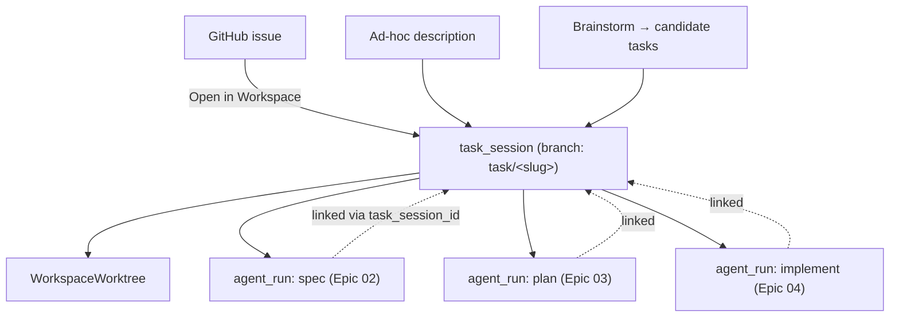

# Epic 01 — Task-Centric Entry & Sessions

## Goal

Make a **task** the unit of work, the way Copilot Workspace does. A user starts from a
GitHub **issue**, an ad-hoc natural-language description, or a **brainstorm**, and Enigma
creates a **task session** that will carry the spec → plan → implementation → validation →
PR loop. This epic delivers the entry points, the session aggregate that links the
downstream agent runs, and a sessions dashboard.

## User Value

- "Open in Workspace" energy: from a GitHub issue to a working session in one click.
- A durable, resumable session — close the tab, come back, continue where you left off.
- A dashboard of recent / bookmarked / completed sessions instead of hunting through workspaces.
- Brainstorm mode for when the task is fuzzy ("improve error handling somewhere in here").

## User Stories

- As a developer, I can list the GitHub issues on my connected repo and start a task session from one; its title/body seeds the task.
- As a developer, I can start an ad-hoc task session from a free-text description without an issue.
- As a developer, I can start a **brainstorm** session that proposes candidate tasks before I commit to one.
- As a developer, I can see all my sessions with status (draft / spec / plan / implementing / validating / completed) and reopen any of them.
- As a developer, each session runs on its **own git worktree/branch**, so multiple tasks coexist.

## Concept mapping (Copilot Workspace → Enigma)

| Copilot Workspace | Enigma |
|---|---|
| Task from issue / PR / ad-hoc | `task_session` seeded from a GitHub issue or free text |
| Session auto-save + dashboard | `task_session` rows + `/sessions` dashboard view |
| Steps: spec / plan / implement | `current_step` enum on the session; artifacts in later epics |
| One task ⇒ one branch | One session ⇒ one `WorkspaceWorktree` (reuse `services/worktrees.py`) |

## Architecture in Enigma

A task session is an **orchestration aggregate**, not new runtime. On creation it:

1. Ensures the repo is cloned (existing `repositories.py`).
2. Creates or adopts a **worktree/branch** for the task (existing `services/worktrees.py`),
   named `task/<session-slug>`.
3. Records the task intent and links every downstream agent run (spec-gen, plan-gen,
   implement, iterations) to the session.

Because `AgentRun` today is single-`prompt` with no linkage (`models/agent.py`), this epic
adds the linkage — align with **improvement-epic 05 (Multi-Turn Agent Sessions)**: either
land that first, or introduce `agent_runs.task_session_id` + `step` here and let 05 build on it.

## Backend Tasks

- **GitHub issues client.** Extend `services/github_client.py` with issue reads (reuse the
  same auth: `x-access-token` + stored PAT, output redaction):
  - `list_issues(repo, state="open", page)` → `GET /repos/{owner}/{repo}/issues` (filter out PRs).
  - `get_issue(repo, number)` → title, body, labels, URL.
- **`TaskSessionService` (`services/task_sessions.py`)**:
  - `create_from_issue(workspace, issue_number)` / `create_adhoc(workspace, description)` —
    resolves the repo, creates/adopts the worktree, persists the session in `draft`.
  - `brainstorm(workspace, description)` — one agent run that returns 3–5 candidate task
    descriptions (structured), no branch created until one is chosen.
  - `get(session_id)` / `list(workspace_id, user_id)` / `advance(session, step)` /
    `bookmark` / `archive`.
  - `link_run(session, agent_run, step)` — used by Epics 02–04.
- **Models + migration**:
  - `task_sessions` (`id`, `workspace_id`, `user_id`, `origin` [`issue`,`adhoc`,`brainstorm`],
    `issue_number` nullable, `title`, `task_text`, `worktree_id` FK, `branch`,
    `current_step` [`draft`,`spec`,`plan`,`implement`,`validate`,`completed`,`error`],
    `status`, `bookmarked` bool, `pr_number` nullable, timestamps).
  - Add `agent_runs.task_session_id` FK (nullable) + `step` label (coordinate with imp-epic 05).
- **Endpoints** (mount under the workspace router, prefix `/workspaces/{id}/tasks`):
  - `GET  /repo/issues` / `GET /repo/issues/{number}` — list/detail GitHub issues.
  - `POST /tasks` — body `{origin, issue_number?, description?}`; creates a session.
  - `POST /tasks/brainstorm` — returns candidate tasks (no session persisted until chosen).
  - `GET  /tasks` / `GET /tasks/{sid}` — list / detail (with linked runs + current step).
  - `POST /tasks/{sid}/bookmark` · `POST /tasks/{sid}/archive`.
- Emit an audit-log entry + notification on session create and step transitions
  (reuse `services/audit.py`, `services/notifications.py`).

## Frontend Tasks

- **Sessions dashboard** — a new top-level view (add a route via `src/lib/router.ts`;
  no react-router). Sections: In progress / Bookmarked / Completed, each row showing title,
  origin badge (issue #/ad-hoc/brainstorm), current step, branch, and last activity.
- **Start-a-task entry** inside a workspace:
  - "From issue" — list `GET /repo/issues`, pick one, preview title/body, **Start**.
  - "Ad-hoc" — a description textarea, **Start**.
  - "Brainstorm" — description in, candidate tasks out, pick one to start.
- **Session shell** — a stepper header (Spec → Plan → Implement → Validate → PR) that later
  epics fill in; wire the active worktree to the session's branch via `activeWorktree.ts`
  so the terminal/agent target the right checkout.
- All calls through typed functions in `src/lib/api.ts` (`listRepoIssues`, `createTaskSession`,
  `listTaskSessions`, …). Icons from `lucide-react`; Tailwind only.

## Database Tasks

- Migration for `task_sessions`; add `task_session_id` + `step` to `agent_runs`.
- Indexes on `workspace_id`, `user_id`, `current_step`, `bookmarked`.
- FK `task_sessions.worktree_id → workspace_worktrees.id`.

## Security Requirements

- Issue listing uses the workspace's stored PAT server-side; never return the token; keep
  the existing output redaction on all GitHub calls.
- Authorization: only members of the workspace's team/project may create or view its sessions.
- Session branch names are validated/slugified (no path traversal, no shell metacharacters)
  before reaching `git worktree` via `DaytonaRuntime.exec`.

## Acceptance Criteria

- A user can list repo issues and start a session from one; the session gets a `task/<slug>`
  worktree and shows `current_step = draft` → `spec`.
- A user can start an ad-hoc session and a brainstorm session (candidates returned).
- The dashboard lists a user's sessions by status and reopens them.
- Every agent run created by later epics is linked to its session (`task_session_id` set).
- Session create + step transitions are audited and notified.

## Dependencies

- **improvement-epic 05 (Multi-Turn Agent Sessions)** — run linkage; coordinate the schema.
- Reuses `services/worktrees.py`, `services/repositories.py`, `services/github_client.py`,
  `services/audit.py`, `services/notifications.py`.
- Feeds Epics 02–04 (they attach artifacts + runs to the session).

## Future Enhancements

- "Open in Enigma" deep links / a GitHub App action on issues.
- Share links that snapshot a read-only session view (Copilot Workspace parity).
- Auto-create a session from an assigned issue via webhook.
