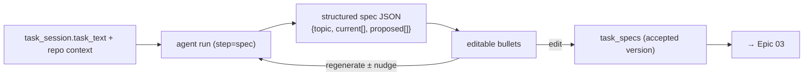

# Epic 02 — Lightweight Specification (current → proposed)

## Goal

Give a task session a **Copilot-Workspace-style specification**: a short, human-readable
artifact with a **topic**, the **current** behaviour of the codebase, and the **proposed**
success criteria after the change — expressed as bullet points, *not* implementation
details. Crucially, the spec is **directly editable**: the user rewrites bullets in place
and the plan/implementation honour the edited version (not just an approve/reject gate).

## User Value

- A fast, readable statement of *what will be true when this is done* — reviewable in
  seconds, unlike a heavyweight `spec.md`.
- The user steers by **editing**, not by round-tripping "request changes" prompts.
- The proposed spec becomes the contract the plan is generated against, so the plan can't
  drift from intent.

## User Stories

- As a developer, from a task session I can generate a spec with a one-line **topic**, a
  **Current** bullet list, and a **Proposed** bullet list.
- As a developer, I can **edit, add, delete, or reorder** any bullet, and edit the topic.
- As a developer, I can **regenerate** the whole spec (discarding edits) or regenerate with
  a natural-language nudge ("focus on the API, ignore the UI").
- As a developer, when I'm happy, I **accept** the spec and move to the plan; the accepted
  version is what the plan step reads.

## How this differs from Spec Kit (`specify`)

Spec Kit's `specify`/`clarify` produce a rich, committed `spec.md` reviewed via
approve / request-changes (the agent regenerates on feedback). Task-mode's spec is:

| | Spec Kit `spec.md` | Task-mode spec |
|---|---|---|
| Shape | Long structured doc | topic + current bullets + proposed bullets |
| Steering | Approve / request-changes → agent regenerates | **Direct inline editing** by the human |
| Persistence | Committed to the feature branch | Stored on the session (optionally committed at completion) |
| Best for | Large features, durable artifacts | Focused issue-shaped tasks |

## Architecture in Enigma

The spec is produced by **one agent run** linked to the session (`step = "spec"`), reading
the task text and repository context, and returning **structured JSON** (topic +
`current[]` + `proposed[]`) rather than freeform markdown — so the UI can render editable
bullets and later steps can consume it reliably. Reuse the existing agent runner and its
read-only tools (`list_files`, `read_file`, `run_command` for read-only inspection); the
spec step writes **no files**.

## Backend Tasks

- **`SpecService` on the session (`services/task_sessions.py` or `services/task_spec.py`)**:
  - `generate(session, nudge=None)` — build the spec prompt (task text + a bounded repo
    context: relevant file list/snippets), run the agent constrained to a **structured
    output schema**, persist a new `task_specs` row (attempt N), set `session.current_step = spec`.
  - `update(session, topic, current[], proposed[])` — persist the human-edited version as the
    current accepted spec (immutable prior attempts kept for history).
  - `accept(session)` — mark the current spec accepted; unlock the plan step.
- **Structured output.** Enforce a JSON schema at the provider layer (OpenAI/OpenHands
  already stream tool calls; use a response schema or a single "emit_spec" tool). Validate
  server-side; on malformed output, retry once then surface an error.
- **Models + migration**:
  - `task_specs` (`id`, `task_session_id` FK, `attempt`, `topic`, `current_json` (list),
    `proposed_json` (list), `source` [`generated`,`edited`], `agent_run_id` FK nullable,
    `accepted` bool, timestamps).
- **Endpoints** (under `/workspaces/{id}/tasks/{sid}/spec`):
  - `POST /generate` — body `{nudge?}`; runs the agent, returns the new spec.
  - `GET  /` — current spec (+ attempt history).
  - `PUT  /` — body `{topic, current[], proposed[]}`; save human edits.
  - `POST /accept` — accept + advance to plan.
  - `WS   /stream` — reuse the agent-run stream to show generation live.

## Frontend Tasks

- **Spec panel** in the session shell: a **topic** input, and two editable bullet lists
  (**Current** / **Proposed**) — add/remove/reorder/edit rows, no component library
  (Tailwind + `lucide-react`). Debounced autosave via `PUT /spec`.
- **Regenerate** button (with an optional nudge field) and a **Reset to generated** action;
  live output via the existing agent-stream component (reuse the `AgentTab` stream view).
- **Accept & continue** advances the stepper to Plan; disabled until at least one proposed
  bullet exists.
- Attempt history: let the user view/restore a previous spec attempt.
- Typed API in `src/lib/api.ts`: `generateTaskSpec`, `getTaskSpec`, `saveTaskSpec`, `acceptTaskSpec`.

## Database Tasks

- Migration for `task_specs`; index on `task_session_id`; unique-ish "current accepted"
  resolved by `accepted` flag + latest `attempt`.
- FK `task_specs.agent_run_id → agent_runs.id`.

## Security Requirements

- Spec generation is **read-only** in the sandbox — no `write_file`/`apply_patch`; keep path
  confinement and the command denylist.
- Repo context sent to the LLM is bounded and must not include workspace secrets or the PAT.
- Authorization: only session members may generate/edit/accept.

## Acceptance Criteria

- Generating a spec returns a topic + non-empty current/proposed bullet lists rendered as
  **editable** rows.
- Editing bullets and reloading shows the edited version persisted.
- Regenerate with a nudge produces a new attempt; prior attempts remain viewable.
- Accepting the spec advances `current_step` to `plan`, and Epic 03's plan generation reads
  the **accepted** spec.
- The spec step writes no files to the worktree.

## Dependencies

- **Epic 01** (task session + run linkage).
- Reuses the agent runner + structured/tool output; benefits from **improvement-epic 04
  (Claude provider)** for stronger specs.

## Future Enhancements

- Offer to **commit** the accepted spec to the branch (bridge to Spec Kit artifacts).
- "Explain this bullet" — expand a proposed bullet into its rationale on demand.
- Detect when the task text implies multiple features and suggest splitting into sessions.
