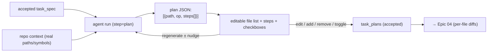

# Epic 03 — File-Level Editable Plan

## Goal

Turn an accepted spec into a **Copilot-Workspace-style plan**: a structured list of the
**files to change** (edit / create / delete / move / rename), each with an ordered list of
**per-file steps** describing the exact change. The plan is **fully editable and
regeneratable** — the user can add/remove files, rewrite steps, and check/uncheck which
files to include — and it is the explicit contract the implementation step consumes.

## User Value

- You see *exactly which files will change and how* before a single diff is generated.
- You steer at the granularity that matters — "don't touch the migration," "also update the
  README" — by editing the plan, not re-prompting.
- Selective execution: implement only the files you've ticked.

## User Stories

- As a developer, after accepting a spec I can generate a plan: a list of files with an
  operation (edit/create/delete/move) and per-file steps.
- As a developer, I can **edit** a file's steps, **add** a file, **remove** a file, change
  its operation, and **reorder** files.
- As a developer, I can **check/uncheck** files to control which ones get implemented.
- As a developer, I can **regenerate** the plan (± a nudge) from the accepted spec.
- As a developer, I **accept** the plan to unlock implementation.

## Concept mapping

| Copilot Workspace plan | Enigma |
|---|---|
| Files to modify (edit/create/delete/move/rename) | `task_plan_files` rows with an `operation` enum |
| Per-file ordered steps | `steps_json` (ordered list) on each file |
| "Update selected files" checkboxes | `included` bool per file |
| Editable + regeneratable | `PUT` edits + `POST /generate` |

## Architecture in Enigma

One agent run (`step = "plan"`) reads the **accepted spec** (Epic 02) plus repository
context and returns **structured JSON**: an array of `{path, operation, rationale,
steps[]}`. The step is **read-only** in the sandbox — it inspects the repo to ground the
plan (real paths, real symbols) but writes nothing. The accepted plan is the manifest the
implementation step (Epic 04) iterates over.

Grounding note: paths in the plan should be validated against the worktree tree
(`services/files.py` / `list_files`) so the file list references real locations for `edit`
and plausible ones for `create`.

## Backend Tasks

- **`PlanService`**:
  - `generate(session, nudge=None)` — requires an accepted spec; build the plan prompt,
    run the agent under a **structured output schema**, validate each `path` against the
    worktree, persist a `task_plans` attempt with its `task_plan_files`, set
    `current_step = plan`.
  - `update(session, files[])` — save human edits (paths, operations, steps, order, `included`).
  - `accept(session)` — mark accepted; unlock implementation (Epic 04).
- **Validation**: reject `operation=edit`/`delete`/`move` on non-existent paths; normalise
  and confine every path to the worktree root (reuse the `agent_tools.py` path-confinement
  helper). Cap the number of files (e.g. `MAX_PLAN_FILES`, default 50) to bound blast radius.
- **Models + migration**:
  - `task_plans` (`id`, `task_session_id` FK, `attempt`, `source` [`generated`,`edited`],
    `agent_run_id` FK nullable, `accepted` bool, timestamps).
  - `task_plan_files` (`id`, `task_plan_id` FK, `order`, `path`, `operation`
    [`edit`,`create`,`delete`,`move`,`rename`], `dest_path` nullable (move/rename),
    `steps_json` (ordered list), `rationale` nullable, `included` bool default true,
    `impl_status` [`pending`,`generating`,`generated`,`applied`,`skipped`,`error`] default `pending`).
- **Endpoints** (under `/workspaces/{id}/tasks/{sid}/plan`):
  - `POST /generate` — body `{nudge?}`.
  - `GET  /` — current plan (files + steps + history).
  - `PUT  /` — body `{files:[...]}`; save edits.
  - `POST /accept` — accept + advance to implement.
  - `WS   /stream` — reuse the agent-run stream.

## Frontend Tasks

- **Plan panel**: a reorderable list of file cards. Each card shows the **path**, an
  **operation** select, a **checkbox** (include), and an editable ordered **steps** list
  (add/remove/reorder/edit). A "+ Add file" control; per-card delete.
- **Regenerate** (± nudge) and **Reset to generated**; live output via the agent-stream view.
- **Accept & continue** → implementation; disabled if zero files are `included`.
- Show validation feedback inline (e.g. "path not found in repo") from the backend.
- Typed API: `generateTaskPlan`, `getTaskPlan`, `saveTaskPlan`, `acceptTaskPlan`. Tailwind +
  `lucide-react`; drag-reorder can be a lightweight custom handler (no new dep).

## Database Tasks

- Migrations for `task_plans` + `task_plan_files`.
- Indexes on `task_session_id`, `task_plan_id`, `included`.
- FK `task_plans.agent_run_id → agent_runs.id`.

## Security Requirements

- Plan generation is **read-only** in the sandbox (no writes).
- Every `path`/`dest_path` is confined to the worktree root and rejected if it escapes.
- Authorization: only session members may generate/edit/accept.
- `MAX_PLAN_FILES` and per-file step caps bound how much the implement step can touch.

## Acceptance Criteria

- Generating a plan returns a file list with operations and per-file steps; `edit` targets
  reference real files in the worktree.
- The user can add/remove/reorder files, edit steps, toggle `included`, and the changes persist.
- Regenerate produces a new attempt; prior attempts are viewable.
- Accepting the plan advances `current_step = implement`; Epic 04 iterates only over
  `included` files.
- Invalid paths are rejected with a clear message.

## Dependencies

- **Epic 02** (accepted spec is the input).
- Reuses the agent runner + structured output, `services/files.py`, and the
  `agent_tools.py` path-confinement helper.

## Future Enhancements

- Impact hints per file (e.g. "3 callers reference this symbol") using a lightweight search.
- Group files into logical change-sets so implementation can batch related edits.
- Warn when the plan omits a file the spec clearly implies (consistency check, à la Spec Kit `analyze`).
