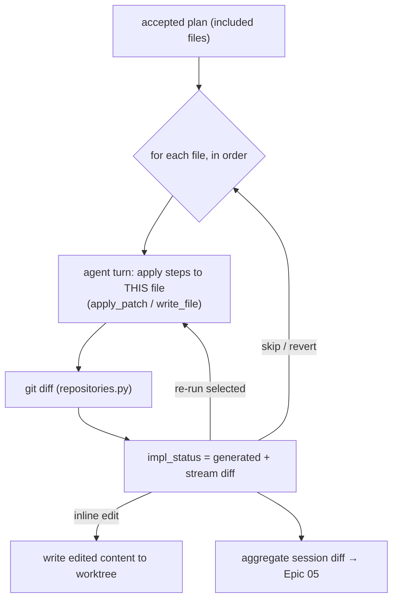

# Epic 04 — Steerable Implementation (editable diffs)

## Goal

Execute the accepted plan the Copilot-Workspace way: generate changes **one file at a
time** as reviewable **diffs**, queued per plan file, where the user can **edit a diff
inline**, **re-run only selected files**, or go back and change the plan. This is the payoff
step — it turns the file-level plan into real, reviewable changes on the session's branch.

## User Value

- Diffs appear file-by-file with clear progress, not one opaque bulk write.
- The human keeps control: tweak a generated diff directly, or uncheck a file and re-run the rest.
- Nothing is committed until the user says so — every change is inspectable first.

## User Stories

- As a developer, I can start implementation; each `included` plan file is processed in
  order and its diff streams in with a status (queued → generating → generated).
- As a developer, I can **edit the generated diff** for a file (minor tweaks) without re-running the agent.
- As a developer, I can **re-run selected files** ("Update selected files") after editing the plan or a diff.
- As a developer, I can **skip** a file or **revert** its changes.
- As a developer, I can see the aggregate `git diff` for the session and proceed to validation/PR (Epic 05).

## Concept mapping

| Copilot Workspace | Enigma |
|---|---|
| Per-file queued diffs generated one-by-one | Iterate `included` `task_plan_files`; `impl_status` per file |
| Directly editable diffs | Write edited content back via `write_file`/`apply_patch` in the worktree |
| "Update selected files" | Re-run implementation for a chosen subset |
| Iterate back to plan/spec | Return to Epic 03/02 (accepted artifacts drive re-runs) |

## Architecture in Enigma

Implementation reuses the **already-shipped** agent edit tools —
`agent_tools.py` exposes both `write_file` (full content) and `apply_patch`
(`PatchResult`) — and the diff surface from `repositories.py` (`git status` + per-file
`git diff`). The orchestrator walks the accepted plan's `included` files:

1. For each file, run an agent turn scoped to **that file + its plan steps**, instructing it
   to apply the change with `apply_patch` (preferred) or `write_file`.
2. After the write, compute the file's `git diff` (existing repo service) and store/stream it.
3. Mark `impl_status = generated`. The user can edit the diff (writes edited content back to
   the worktree) or accept it as-is.

All writes land in the **session's worktree** (Epic 01), so changes are isolated to the
task's branch and never touch the base clone.

## Backend Tasks

- **`ImplementationService`**:
  - `run(session, file_ids=None)` — implement all `included` files, or just `file_ids`
    ("update selected"). Per file: build the per-file prompt (plan steps + current file
    content), run one agent turn constrained to `apply_patch`/`write_file` **on that path
    only**, then compute and persist the file diff; update `impl_status`.
  - `edit_file(session, plan_file_id, new_content | patch)` — apply a human edit to the
    worktree via the same tools; recompute the diff.
  - `revert_file(session, plan_file_id)` — `git checkout -- <path>` (or restore) in the
    worktree; reset `impl_status = pending`.
  - `aggregate_diff(session)` — full worktree `git status` + diffs for Epic 05 / review.
- **Per-file confinement**: each agent turn is only permitted to modify its target `path`
  (reject writes to other paths); reuse `agent_tools.py` path confinement and the
  denylist/allowlist. Stream tool-call/thinking events over the existing agent WebSocket,
  tagged with `plan_file_id`.
- **Storage**: reuse `task_plan_files.impl_status`; add a `task_file_diffs` table (or store
  the latest diff + `agent_run_id` per plan file) for history: (`id`, `task_plan_file_id`,
  `attempt`, `diff_text`, `bytes_changed`, `agent_run_id` FK, `source` [`agent`,`human`],
  timestamps).
- **Endpoints** (under `/workspaces/{id}/tasks/{sid}/implement`):
  - `POST /run` — body `{file_ids?}`; run all-included or selected.
  - `GET  /` — per-file impl status + latest diffs.
  - `PUT  /files/{pfid}` — body `{content?|patch?}`; apply human edit.
  - `POST /files/{pfid}/revert` — revert that file.
  - `GET  /diff` — aggregate session diff.
  - `POST /stop` — stop an in-flight run (reuse the existing agent-run stop path).
  - `WS   /stream` — per-file implementation events (reuse agent stream, add `plan_file_id`).

## Frontend Tasks

- **Implementation panel**: the plan's file list with live status chips (queued /
  generating / generated / applied / skipped / error) and a **diff viewer** per file.
- **Editable diffs**: allow inline edits in the diff/file view; **Save** writes back via
  `PUT /files/{pfid}` and refreshes the diff. (Reuse the code-server editor for deeper edits
  — the worktree is the same filesystem.)
- **Update selected files**: multi-select + re-run button → `POST /run {file_ids}`.
- **Per-file actions**: skip, revert, re-run this file. **Stop** for an in-flight run.
- **Aggregate diff** view + a "Proceed to validation" CTA (Epic 05).
- Live events via the existing agent-stream component (reuse `AgentTab`), keyed by
  `plan_file_id`. Typed API: `runTaskImplementation`, `getTaskImplementation`,
  `editTaskFile`, `revertTaskFile`, `getTaskDiff`.

## Database Tasks

- Migration for `task_file_diffs` (or the chosen diff-history store); reuse
  `task_plan_files.impl_status`.
- Indexes on `task_plan_file_id`, `attempt`.
- FK to `agent_runs.id`.

## Security Requirements

- Each per-file agent turn may write **only** its target path; all writes confined to the
  worktree root; base clone is never modified.
- Human diff edits go through the same confinement/validation as agent writes.
- Nothing auto-commits; commit/push happens only in Epic 05 under an explicit action.
- Keep the `agent_tools.py` command denylist/allowlist and the `apply_patch` size caps.

## Acceptance Criteria

- Running implementation processes each `included` file in order, producing a per-file diff
  and updating `impl_status`.
- Editing a diff inline persists to the worktree and the recomputed diff reflects the edit.
- "Update selected files" re-runs only the chosen files, leaving others untouched.
- Revert restores a file and resets its status; stop halts an in-flight run.
- The aggregate diff matches `git diff` in the worktree; nothing is committed automatically.

## Dependencies

- **Epic 03** (accepted plan drives the file loop).
- Reuses **improvement-epic 03 (Agent Editing Tools)** — `apply_patch` already exists —
  the agent runner/stream, and `repositories.py` diffs. Benefits from **improvement-epic 05
  (Multi-Turn Sessions)** for per-file iterative turns.

## Future Enhancements

- Auto-run validation (Epic 05) after each file and feed failures back into the next turn.
- Conflict handling when a human edit and an agent re-run touch the same file.
- Partial-hunk staging (accept some hunks of a diff, regenerate the rest).
