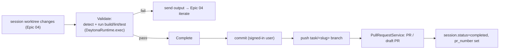

# Epic 05 — Integrated Validation & Completion

## Goal

Close the Copilot-Workspace loop: let the user **validate** the implemented changes
(build / lint / test) in the sandbox as a first-class session step, feed failures back into
iteration, and then **complete** the task by committing to the session branch and opening a
**pull request** (or draft PR, or push-only). This ties the task loop to Enigma's existing
terminal, preview/dev-server, and PR client.

## User Value

- Validate without leaving the flow — see build/lint/test results against the actual changes.
- Failures become actionable: jump back to plan/implementation (Epics 03/04) with the error in hand.
- One-click finish: commit under your identity → PR, exactly where a Copilot Workspace task ends.

## User Stories

- As a developer, from a session with generated changes I can run **Validate** — the system
  detects and runs the project's build/lint/test commands in the worktree and reports pass/fail + output.
- As a developer, on failure I can send the failing output back to implementation to iterate.
- As a developer, I can **complete** the task: commit the worktree changes (as me) and open a
  **PR**, a **draft PR**, or just **push the branch**.
- As a developer, the resulting PR number/URL is shown on the session and the session is marked completed.

## Concept mapping

| Copilot Workspace | Enigma |
|---|---|
| Integrated terminal (Codespace-backed) for build/lint/test | Reuse terminal (`services/terminal.py`) + custom commands + `DaytonaRuntime.exec` |
| Validate step | `task_validations` runs tied to the session |
| Completion: create PR / draft PR / push / update PR | Reuse `services/worktrees.py` commit/push + `PullRequestService` |
| Live preview | Reuse existing preview/dev-server ("Run App") |

## Architecture in Enigma

Validation reuses the sandbox execution paths already in place. Command detection mirrors
the **Preview** feature, which already auto-detects the toolchain via `mise`
(`preview.py` / `dev_server.py`): from that toolchain, resolve the project's
**build / lint / test** commands (mise tasks or `package.json` scripts / `pytest` / etc.),
run them via `DaytonaRuntime.exec` in the session's worktree, and stream output. Completion
reuses the shipped **commit → push → PR** path (`repositories.py` commit — which already
accepts an author override — `services/worktrees.py`, and `PullRequestService`).

## Backend Tasks

- **`ValidationService`**:
  - `detect(session)` — resolve build/lint/test commands from the worktree toolchain (reuse
    the Preview detection in `preview.py`/`dev_server.py`; fall back to sensible defaults per
    ecosystem). Allow per-workspace overrides.
  - `run(session, kinds=["build","lint","test"])` — execute each via `DaytonaRuntime.exec`
    in the worktree, capture exit code + output, persist a `task_validations` row, stream output.
  - `feedback_payload(validation)` — a compact failure summary Epic 04 can prepend to a re-run.
- **Completion (`CompletionService` or extend `TaskSessionService`)**:
  - `complete(session, mode, title, body, base=default_branch)` where `mode ∈
    {pr, draft_pr, push}`:
    - stage + commit the worktree (reuse `repositories.py` commit with the **signed-in
      user** as author/email — the override already exists),
    - push `task/<slug>` (worktrees are configured `push.autoSetupRemote=true`),
    - for `pr`/`draft_pr`, call `PullRequestService.create(...)` (set `draft=true` for draft),
    - persist `pr_number`/URL on the session; set `current_step=completed`.
- **Models + migration**:
  - `task_validations` (`id`, `task_session_id` FK, `kind` [`build`,`lint`,`test`],
    `command`, `exit_code`, `passed` bool, `output` text (truncated/redacted), `duration_ms`,
    timestamps).
  - Reuse `task_sessions.pr_number`; add `completed_at`, `completion_mode`.
- **Endpoints** (under `/workspaces/{id}/tasks/{sid}`):
  - `GET  /validate/detect` — resolved commands.
  - `POST /validate` — body `{kinds?}`; run + return results. `WS /validate/stream` for live output.
  - `POST /complete` — body `{mode, title, body}`; commit + push + PR; returns PR info.

## Frontend Tasks

- **Validation panel**: buttons for Build / Lint / Test (and "Run all"), each showing
  pass/fail + streamed output (reuse the command-run/terminal stream components). A
  **"Fix in implementation"** action carries the failing output back to Epic 04.
- **Preview integration**: surface the existing "Run App" preview so the user can eyeball the
  change (no new backend — reuse `PreviewPanel`).
- **Complete task** dialog: choose PR / draft PR / push-only, edit title + body (seeded from
  the task/spec), confirm. On success show the PR link and mark the session completed.
- Typed API: `detectTaskValidation`, `runTaskValidation`, `completeTaskSession`. Tailwind +
  `lucide-react`.

## Database Tasks

- Migration for `task_validations`; add `completed_at`, `completion_mode` to `task_sessions`.
- Indexes on `task_session_id`, `kind`.

## Security Requirements

- Validation commands run **inside the sandbox** via `DaytonaRuntime.exec`, confined to the
  worktree; command resolution must not execute arbitrary user-supplied strings without the
  same guarding used elsewhere.
- Commit uses the signed-in user's identity; the PAT stays server-side and every git/API
  output is **redacted** (existing behaviour).
- Validation output is truncated + secret-redacted before storage/streaming.
- Authorization: only session members may validate/complete; PR creation requires the
  workspace GitHub token.
- Emit audit-log entries + notifications on validate, commit/push, and PR creation (reuse
  `services/audit.py`, `services/notifications.py`).

## Acceptance Criteria

- **Validate** detects and runs the project's build/lint/test in the worktree and reports
  pass/fail with output; a failure can be pushed back into implementation.
- **Complete** commits the worktree under the signed-in user, pushes `task/<slug>`, and
  opens a PR (or draft PR, or push-only) via the existing PR client.
- The session shows the PR number/URL and is marked `completed`; the action is audited and notified.
- No secrets or tokens appear in stored/streamed output.

## Dependencies

- **Epic 04** (there are changes to validate/ship).
- Reuses `services/terminal.py`, `preview.py`/`dev_server.py` (detection), `repositories.py`
  (commit), `services/worktrees.py` (push), `PullRequestService` (PR),
  `services/audit.py`, `services/notifications.py`.

## Future Enhancements

- Auto-validate after each implemented file and auto-loop fixes until green (bounded retries).
- **Update-PR** mode for sessions started from an existing PR (Copilot Workspace parity).
- Session **share links** (read-only snapshot) and **undo/redo** across steps to fully match
  Copilot Workspace's session management.
- Post the plan/spec as a comment on the originating GitHub issue when the PR opens.
